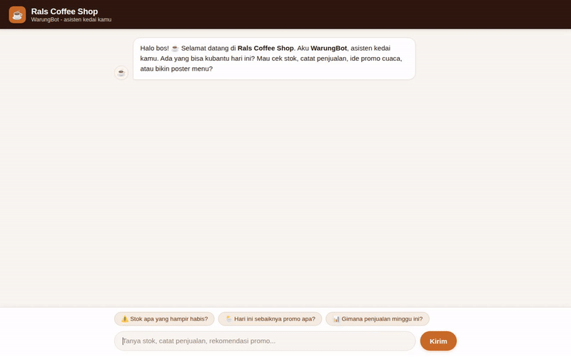

# WarungBot ☕

> **WarungBot — Asisten Pintar Kedai Kopi (Rals Coffee Shop)**  
> Built with Google Cloud Vertex AI, Agent Development Kit (ADK), Gemini 2.5 Flash, Cloud Firestore, Cloud Storage, and A2UI.



---

## 📌 Overview

**WarungBot** is an autonomous AI assistant built for small Indonesian coffee shop (warung kopi) owners and staff. It manages daily café operations by querying real-time inventory from Firestore, recording sales transactions in Indonesian Rupiah (IDR), fetching live weather data to recommend timely promotions, generating marketing visuals (promotional posters & video clips) with Gemini and uploading them to Cloud Storage, and presenting structured data as rich A2UI cards.

---

## 🛠️ Google Cloud Services & Tools Implemented

Based on the codebase in `app/` and `agents-cli-manifest.yaml`, WarungBot wires up the following tools and services:

| Component / Service | Implementation in Code | Description |
|---|---|---|
| 🤖 **Reasoning Core** | `google.adk` + `Gemini(model="gemini-2.5-flash")` | Core reasoning agent handling user intent, tool selection, and conversational Indonesian language. |
| 🧠 **Vertex AI Memory Bank** | `PreloadMemoryTool` + `after_agent_callback` (`add_session_to_memory`) | Cross-session long-term memory that extracts and recalls owner preferences (e.g. brand aesthetics, signature recipes, promotional styles). |
| 🗄️ **Google Cloud Firestore** | `google.cloud.firestore` (`app/tools/firestore_tools.py`) | Structured database managing `products` (inventory stock, prices, minimum stock thresholds) and `sales` (transaction logs). |
| 🖼️ **Google Cloud Storage** | `google.cloud.storage` (`app/tools/image_tool.py`, `app/tools/video_tool.py`) | Media bucket storing generated marketing posters (`/posters`) and video teasers (`/videos`) with public asset URLs. |
| 🎨 **Image Generation** | `gemini-3.1-flash-lite-image` via `google.genai` SDK | Generates aesthetic promotional posters for coffee drinks and pastries. |
| 🎬 **Video Generation** | `gemini-omni-flash-preview` via `google.genai` SDK | Generates short promotional video clips for menu items. |
| 🧪 **Code Sandbox** | `AgentEngineSandboxCodeExecutor` | Executes Python code in a Vertex AI Reasoning Engine sandbox for profit margin and financial calculations in IDR. |
| 🌦️ **Weather Integration** | Open-Meteo REST API (`app/tools/weather_tool.py`) | Real-time weather and temperature lookup for Indonesian cities (Jakarta, Bandung, Surabaya, etc.) to drive contextual menu promos. |
| 🎴 **A2UI (Agent-to-User Interface)** | `a2ui.schema.manager` + `a2ui_callback` | Emits structured v0.8 A2UI JSON components (`Card`, `Column`, `Row`, `Text`, `Image`) for catalog and stock alert cards. |
| 🌐 **Frontend & A2A Proxy** | FastAPI + `a2a.client` (`frontend/`) | Responsive web chat interface with an A2A protocol proxy connecting directly to Agent Runtime. |

---

## 🔧 Implemented Agent Tools

1. **`PreloadMemoryTool`**: Automatically searches and injects relevant cross-session owner memories into the system prompt at the start of every turn.
2. **`list_products(category)`**: Queries Firestore for active menu items, stock counts, and prices in Rupiah.
3. **`get_low_stock()`**: Filters inventory for items at or below minimum threshold (e.g., Croissant, Matcha Latte).
4. **`record_sale(product_id, quantity, payment_method, note)`**: Records completed transactions into Firestore `sales` collection and deducts inventory stock.
5. **`update_stock(product_id, new_stock, reason)`**: Updates item inventory levels in Firestore.
6. **`get_sales_summary(days)`**: Aggregates revenue, units sold, and top products over a specified time window.
7. **`get_weather(city)`**: Checks temperature and conditions (cerah, berawan, hujan) to recommend cold drinks or warm pastries.
8. **`generate_poster(item_name, prompt_details)`**: Creates a marketing poster with `gemini-3.1-flash-lite-image` and saves it to Cloud Storage.
9. **`generate_video(item_name, prompt_details)`**: Creates a short video clip with `gemini-omni-flash-preview` and uploads it to Cloud Storage.

---

## 🏗️ Project Structure

```
warungbot/
├── app/
│   ├── agent.py               # Root ADK agent configuration, instruction & tools
│   ├── a2ui_utils.py          # A2UI v0.8 schema manager & callback transformer
│   └── tools/                 # Domain tools
│       ├── firestore_tools.py # Firestore inventory & sales tools
│       ├── weather_tool.py    # Open-Meteo live weather tool
│       ├── image_tool.py      # Gemini image generation & Cloud Storage upload
│       └── video_tool.py      # Gemini Omni video generation & Cloud Storage upload
├── frontend/                  # Web chat interface
│   ├── main.py                # FastAPI proxy with A2A client
│   └── static/
│       └── index.html         # Responsive coffee shop UI & A2UI card renderer
├── demo.gif                   # Looping agent demo recording
├── project_brief.md           # Project brief & tool coverage specification
├── seed_firestore.py          # Script to populate initial Firestore inventory data
├── pyproject.toml             # Python dependencies
└── agents-cli-manifest.yaml   # ADK agent manifest
```

---

## 🚀 Setup & Local Execution

### 1. Prerequisites
- Python 3.11+
- [`uv`](https://docs.astral.sh/uv/) package manager
- Google Cloud SDK (`gcloud`) with credentials configured:
  ```bash
  gcloud auth application-default login
  ```

### 2. Install Dependencies & Seed Firestore
```bash
# Sync Python virtual environment
uv sync

# Populate Firestore with initial coffee shop products and sales data
uv run python seed_firestore.py
```

### 3. Run the Agent Locally in ADK Web UI
```bash
uv run adk web . --host 127.0.0.1 --port 8080 --allow_origins '*'
```

### 4. Run the Custom Web Frontend Proxy
```bash
cd frontend
uv run uvicorn main:app --host 127.0.0.1 --port 8000
```
